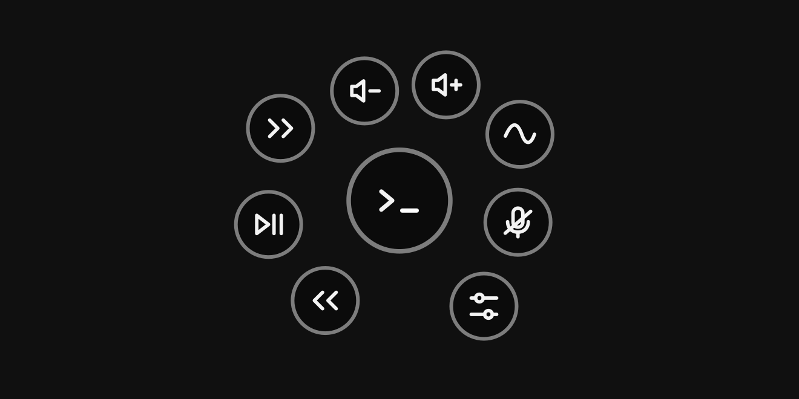

# Pet

English · [Русский](README.ru.md)

A small, draggable Linux desktop companion with a blinking terminal prompt, floating media controls, and hands-free voice commands.



## Install and run

Install the [system dependencies](#system-dependencies), then clone the project and run the installer.

```bash
git clone https://github.com/George-Salt/pet.git
cd pet
./install --voice
pet
```

The installer runs as your user, creates an application menu entry, and puts `pet` in `~/.local/bin`. Add that directory to your `PATH` if your shell cannot find the command. Use `./install` to skip the optional voice models. Pet runs in the background after you close the terminal. Stop it with `pet --quit` or the power button in its settings.

## Desktop compatibility

| Session | Behavior |
| --- | --- |
| Wayland with layer-shell, such as Hyprland, KDE Plasma, and Sway | Overlay on each display, with click-through outside Pet and its controls |
| Wayland without layer-shell, such as GNOME | Draggable window managed by the compositor |
| X11 | Compact window that requests always-on-top and all-workspace placement |

Left-click Pet to open its floating controls. They follow while you drag Pet and rearrange near screen edges. Right-click to open settings, where you can change the border, background, and accent color.

Hyprland provides compositor blur and automatic per-monitor hiding over fullscreen windows. Use the monitor button in settings or run `pet --fullscreen=hide` or `pet --fullscreen=show`. Voice controls keep working while the overlay is hidden.

## Voice and media

Say **«Пэт, вперёд»** to skip to the next track. You can also say **«Пэт»** and give a command within a few seconds. Voice commands are in Russian. Track titles can be recognized in Russian or English when the corresponding Vosk models are installed. Speech recognition runs locally while the microphone toggle is on.

| Action | Example after «Пэт» |
| --- | --- |
| Next track | «вперёд», «дальше», «следующий трек» |
| Previous track | «назад», «предыдущий трек» |
| Volume up / down | «громче» / «тише» |
| Pause / resume | «пауза» / «продолжи» |

The microphone button or `pet --voice=off` stops listening. Use `pet --voice=on` to resume. Pet uses MPRIS for media controls and adjusts the active audio output in five-percentage-point steps.

## Yandex Music through PulseSync

With the Yandex Music desktop app and PulseSync installed, run `./setup-pulsesync` from the project directory to build and install the local Pet Music add-on. This requires Node.js 22.12 or later and npm. Keep Yandex Music and PulseSync running for playback. The player window can stay minimized.

| Voice command | Terminal equivalent |
| --- | --- |
| «Пэт, включи Hello, исполнитель Адель» | `pet --yandex-search Hello --artist Adele` |
| «Пэт, включи песни артиста Кино» | `pet --yandex-artist Кино` |
| «Пэт, включи плейлист Мне нравится» | `pet --yandex-favorites` |
| «Пэт, моя волна» | `pet --yandex-wave` |

For **Мне нравится**, open the built-in playlist in Yandex Music and give the command once so Pet can remember it for your account. You can also play a known track ID with `pet --yandex-track=150139411:41528093`.

## System dependencies

Arch Linux and CachyOS:

```bash
sudo pacman -S --needed python gtk3 gtk-layer-shell python-gobject python-cairo \
  playerctl pipewire wireplumber curl unzip util-linux
```

Debian and Ubuntu:

```bash
sudo apt install python3 python3-venv python3-gi python3-gi-cairo gir1.2-gtk-3.0 \
  gir1.2-gtklayershell-0.1 playerctl pulseaudio-utils curl unzip util-linux
```

GTK Layer Shell is optional in compact-window mode. Audio and microphone controls work through PipeWire or PulseAudio. You can install the Vosk models later with `./setup-voice` (about 85 MB). If installed locally, **Minecraft Rus** is used for tooltips.

### Start Pet on login

For Hyprland with Lua configuration:

```lua
hl.on("hyprland.start", function()
    hl.exec_cmd("pet")
end)
```

For `hyprland.conf`:

```ini
exec-once = pet
```

In KDE Plasma and other desktops, add **Pet** in the desktop's autostart settings.

## Contributing

File a bug or request a feature in [Issues](https://github.com/George-Salt/pet/issues/new/choose). See [Contributing](CONTRIBUTING.md) for development and pull requests. Source code is available under the [MIT License](LICENSE).
