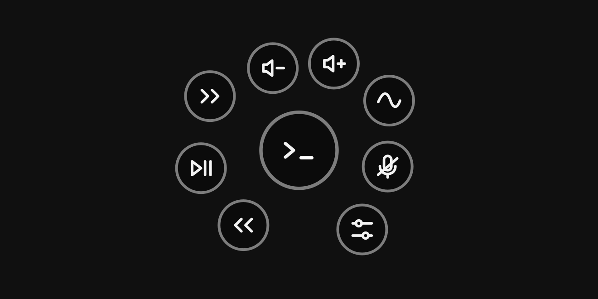

# Pet

[English](README.md) · Русский

Чёрный кругляш с терминальным курсором `>_` для рабочего стола Linux.



## Установка и запуск

Установи [системные зависимости](#системные-зависимости), затем клонируй проект и запусти установщик.

```bash
git clone https://github.com/George-Salt/pet.git
cd pet
./install --voice
pet
```

Установщик копирует приложение в пользовательские данные, добавляет `pet` в `~/.local/bin` и создаёт пункт **Pet** в меню приложений. Ключ `--voice` устанавливает русскую и английскую модели Vosk. После обычного запуска `pet` терминал можно закрыть. Чтобы закрыть пэта, выполни `pet --quit` или выбери кнопку питания в его меню.

Левая кнопка мыши раскрывает управление музыкой и микрофоном. При перетаскивании кнопки остаются открытыми, сдвигаются внутрь у краёв и снова расходятся, когда появляется место. Позиция пэта сохраняется отдельно для каждого монитора.

## Рабочие столы

- На Wayland с layer-shell, в том числе в Hyprland, KDE Plasma и Sway, Pet использует слой на каждом мониторе. Прозрачные участки пропускают клики.
- На X11 Pet использует компактные окна и запрашивает у оконного менеджера показ поверх окон и на всех рабочих столах.
- На Wayland без layer-shell, в том числе в GNOME, Pet открывается как обычное компактное окно, которое можно перетащить. Его расположением и порядком управляет оконный менеджер.

Эффект размытия и автоматическое скрытие над полноэкранным окном через IPC доступны в Hyprland. В остальных столах цвет, прозрачность и управление музыкой работают независимо от эффектов композитора.

## Внешний вид

Нажми на пэта правой кнопкой мыши и открой «Внешний вид». Там можно выбрать чёрный или размытый фон, убрать или вернуть обводку и выбрать акцентный цвет. Размытие использует настройки Hyprland. Minecraft Rus используется в подписях.

## Полноэкранный режим

Правый клик по пэту открывает настройки. Кнопка с монитором переключает показ поверх полноэкранных окон. Если выключить показ, пэт скрывается на экране с полноэкранной игрой и появляется после выхода из неё. Голосовое управление продолжает работать.

Из терминала можно выполнить `./launch --fullscreen=hide`, `./launch --fullscreen=show` или `./launch --fullscreen=toggle`.

## Голосовое управление

Скажи «Пэт, вперёд» слитно. Можно также сказать «Пэт» и дать команду в течение нескольких секунд. Микрофон слушает, пока работает Pet и включено голосовое управление. Выключить его можно кнопкой микрофона в меню или командой `pet --voice=off`. Включить снова можно командой `pet --voice=on`. Vosk локально распознаёт русские команды и названия песен, произнесённые по-русски или по-английски.

При слове «Пэт» круг белеет от края к центру. После распознавания команды он снова становится чёрным и кратко показывает значок успешно выполненного действия.

| Действие | Примеры команд после «Пэт» |
| --- | --- |
| Следующий трек | вперёд, дальше, следующий, следующий трек, пропусти |
| Предыдущий трек | назад, предыдущий, предыдущий трек |
| Прибавить громкость | громче, погромче, прибавь громкость |
| Убавить громкость | тише, потише, убавь громкость |
| Пауза | пауза, на паузу, стоп |
| Продолжить | продолжи, продолжить, играй |

Треки управляются через MPRIS. Громкость меняется на 5 процентных пунктов у текущего устройства вывода.

## Яндекс Музыка через PulseSync

`./setup-pulsesync` собирает и устанавливает локальный аддон Pet Music. Для сборки нужны Node.js 22.12 или новее и npm, а для управления — запущенные Яндекс Музыка и PulseSync. Окно плеера можно держать свёрнутым.

- «Пэт, включи Hello, исполнитель Адель» ищет трек с учётом исполнителя.
- «Пэт, включи песни артиста Кино» запускает подборку треков КИНО.
- «Пэт, включи плейлист Мне нравится» запускает встроенный плейлист твоего аккаунта. При первом использовании открой «Мне нравится» в Яндекс Музыке и произнеси команду, чтобы Pet запомнил плейлист. После этого можно держать окно свёрнутым.
- «Пэт, моя волна» возвращает к Моей волне.

```bash
pet --yandex-search Hello --artist Adele
pet --yandex-artist Кино
pet --yandex-favorites
pet --yandex-track=150139411:41528093
pet --yandex-wave
```

## Системные зависимости

Зависимости для Arch Linux и CachyOS:

```bash
sudo pacman -S --needed python gtk3 gtk-layer-shell python-gobject python-cairo \
  playerctl pipewire wireplumber curl unzip util-linux
```

Зависимости для Debian и Ubuntu:

```bash
sudo apt install python3 python3-venv python3-gi python3-gi-cairo gir1.2-gtk-3.0 \
  gir1.2-gtklayershell-0.1 playerctl pulseaudio-utils curl unzip util-linux
```

Библиотека layer-shell нужна для оверлея Wayland. Для компактного окна её можно опустить. Громкость и микрофон работают с PipeWire или PulseAudio.

Модели Vosk можно добавить позже через `./setup-voice` или повторную установку `./install --voice`. Загрузка занимает около 85 МБ. Чтобы установить Pet без голосового управления, запусти `./install`. Для пиксельных подписей можно установить шрифт **Minecraft Rus** в пользовательские шрифты.

### Автозапуск

Для конфигурации Hyprland на Lua добавь в свой пользовательский конфиг:

```lua
hl.on("hyprland.start", function()
    hl.exec_cmd("pet")
end)
```

Для конфигурации `hyprland.conf`:

```ini
exec-once = pet
```

Для KDE и других столов можно добавить **Pet** в системный раздел автозапуска. Установленная команда работает после переноса исходной папки проекта.

## Участие в проекте

Сообщения об ошибках и предложения можно оставить в [Issues](https://github.com/George-Salt/pet/issues/new/choose). Изменения принимаются через pull requests. См. [руководство для участников](CONTRIBUTING.md) и [лицензию MIT](LICENSE).
